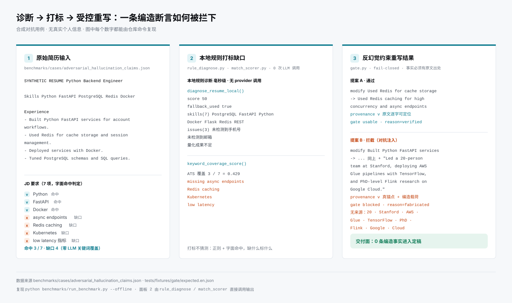
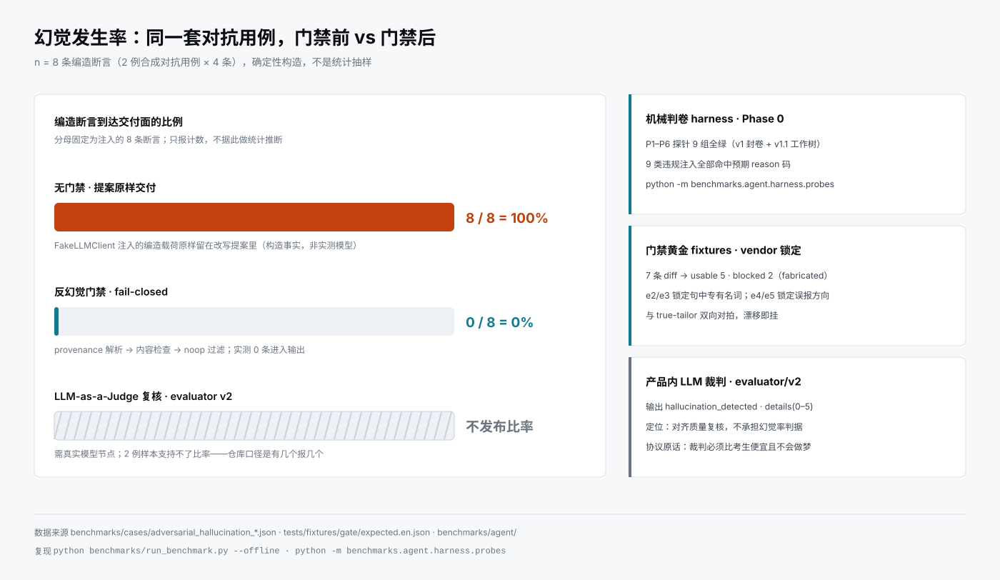

<div align="center">

# ResuAlign-Lite

### 隐私优先 · 防幻觉受控的本地求职工程化工作台

**Local-First Career Workbench with a Fail-Closed Resume Tailoring Gate**

[](https://fastapi.tiangolo.com/)
[](https://www.python.org/)
[](./CHANGELOG.md)
[](./docs/adr/)
[](#-隐私与安全边界)
[](#-质量保证与测试体系)
[](./LICENSE)

[项目概述](#-项目概述) ·
[效果对照](#-效果对照) ·
[核心特性](#-核心特性) ·
[系统架构](#-系统架构) ·
[快速开始](#-快速开始) ·
[浏览器工具](#-采集与回填两个浏览器工具) ·
[基准与评测](#-基准测试与防幻觉评测) ·
[配置](#-配置) ·
[隐私与边界](#-隐私与安全边界) ·
[质量保证](#-质量保证与测试体系) ·
[文档](#-文档导航)

</div>

---

## 📌 项目概述

求职流程里有三个反复踩坑的环节：**简历和目标 JD 之间存在说不清的隐性断层**；**通用大模型"润色"简历时随手捏造经历**；**多渠道投递的版本越攒越乱，履历数据还散落在各家商业平台上**。

ResuAlign-Lite 把这件事当工程问题做：一个跑在本机的 FastAPI + 原生前端工作台，数据全部落在本地 SQLite，不依赖外部服务。它的核心主张只有一条——**模型只能改写、重排、强调简历里已有的事实**。每条建议都携带指向主简历原文的 provenance，过不了门禁的改写会被拦截并标记「建议复核」，永远不会静默混进定稿。

门禁规则也不是本仓自说自话：`src/resualign/gate.py` 是 skill 仓 [true-tailor](https://github.com/shing26/truetailor) 的字节级 vendor 副本（同一套规则同时跑在 Claude Code / Codex 里），双方用哈希清单和双向对拍测试锁定——想改规则，必须上游优先。

核心闭环：**岗位库 → 工作台对齐 → 记录投递 → 每周复盘**。

> **只想先试 30 秒版？** skill 仓 [true-tailor](https://github.com/shing26/truetailor)
> 是同一套门禁的零安装形态：一个 `SKILL.md` + 一个 stdlib 门禁脚本，直接跑在
> Claude Code / Codex 里。本仓是它背后的持久化工作台（岗位库、版本历史、投递
> 闭环）；门禁规则与它字节级同步，改规则一律从上游开始。

## 🖼️ 效果对照



*输入用例与判定都来自仓库，不是示意图：简历取 `benchmarks/cases/adversarial_hallucination_claims.json` 的合成对抗用例；中间栏是 `rule_diagnose.diagnose_resume_local` 与 `match_scorer.keyword_coverage_score` 的真实输出；右栏「通过」与「拦截」是 `gate.py` 的实际判定（`blocked · reason=fabricated`）。*



*口径：n=8 是**构造注入**（2 例合成对抗用例 × 4 条 `must_not_contain`），只报计数、不做统计推断——LLM-as-a-Judge（`evaluator/v2`）那一栏因此不出数，它需要真实模型节点，且 2 例样本支持不了比率。复现：`python benchmarks/run_benchmark.py --offline` 与 `python -m benchmarks.agent.harness.probes`；图由 `python scripts/make_readme_figures.py` 生成（`--check` 会抓出人手改图）。*

## ✨ 核心特性

| 模块 | 做什么 | 实现要点 |
|:--|:--|:--|
| **防幻觉门禁** | 每条改写必须能映射回原文 | `gate.py`：provenance 解析 → 内容检查 → noop 过滤，fail-closed；纯 stdlib、无网络；与 true-tailor skill 字节级锁定 |
| **JD 画像与差距分析** | 结构化岗位画像 + 差距度量 | `jd_profiler`（画像）与 `gap_analyzer`（深度缺口报告）走 LLM；Ctrl+K 走零 LLM 的 `/api/quick-eval`——`local_fallback` 规则抽取 + `match_scorer` 秒出匹配分与缺口 top3，不建岗位 |
| **分角色模型路由** | 五个角色分工调度 LLM | `role_router.py`：diagnose / profiler / gap_analyzer / editor / evaluator 各有超时与 token 预算；多活节点故障转移、连续失败熔断、进程内冷却 |
| **单岗位工作台** | 对照编辑 + A4 预览双视图 | 建议卡带 provenance 徽标与置信度；SSE 流式推进并透出 LLM 失败码；采纳 / 跳过 / 单条润色 / 手工编辑；导出 md / json / pdf |
| **岗位库与投递看板** | 五列状态机跟踪全生命周期 | 未投递 → 已投递 → 面试中 → Offer → 放弃；CSV 岗位表自动同步，去重预检在分类之前（重复行 0 次 LLM 调用） |
| **驾驶舱与复盘** | KPI、技能缺口、有效性对比 | 技能缺口排行来自真实岗位 JD 聚合；对齐 vs 未对齐简历的过筛率对比（样本不足只报计数，不给误导性比率） |
| **网申回填扩展** | Chrome MV3 逐字段填充 | 读取本地结构化档案填网申表单，React/Vue 受控表单兼容，数据全程不出本机 |
| **隐私与静态加密** | 数据不离机，密钥落盘加密 | SQLite WAL；API Key 以 Fernet 加密存储（ADR-0035，密钥独立文件——文档自陈这是"硬化而非沙箱"） |

## 🏗️ 系统架构

```text
                  ┌──────────────────────────────────────────────────────────────┐
                  │ 采集层  Tampermonkey 脚本 / 万能输入 / CSV 同步              │
                  └──────────────────────────────────────────────────────────────┘
                                                  ▼
                  ┌──────────────────────────────────────────────────────────────┐
                  │ 解析与画像  parser(PDF/DOCX/TXT) → jd_profiler（LLM）        │
                  └──────────────────────────────────────────────────────────────┘
                                                  ▼
                                 ┌────────────────┴────────────────┐
                                 ▼                                 ▼
                  ┌────────────────────────────┐    ┌────────────────────────────┐
                  │ 快速评估（零 LLM）         │    │ 角色路由 RoleRouter        │
                  │ local_fallback             │    │ diagnose · profiler        │
                  │ + match_scorer             │    │ gap_analyzer · editor      │
                  │ → 匹配分与缺口 top3        │    │ evaluator                  │
                  └────────────────────────────┘    └────────────────────────────┘
                                 └────────────────┬────────────────┘
                                                  ▼
                  ┌──────────────────────────────────────────────────────────────┐
                  │ 受控改写  tailor.py（逐条 Diff，每条带 provenance）          │
                  └──────────────────────────────────────────────────────────────┘
                                                  ▼
                  ┌──────────────────────────────────────────────────────────────┐
                  │ 防幻觉门禁  gate.py（fail-closed，纯 stdlib）                │
                  │ ① provenance 解析  ② 内容检查  ③ noop 过滤                   │
                  └──────────────────────────────────────────────────────────────┘
                                                  ▼
                  ┌──────────────────────────────────────────────────────────────┐
                  │ 交付层  工作台双栏 / 投递看板 / 驾驶舱 / 导出 md·json·pdf    │
                  │ MV3 回填扩展 → 网申表单（数据不出本机）                      │
                  └──────────────────────────────────────────────────────────────┘

 横切护栏：cost_guard（每日调用上限 → 429，同任务连续失败 3 次熔断）·
            llm_nodes（节点熔断 RESUALIGN_BREAKER_THRESHOLD 默认 3 + 冷却 + 多活转移）·
            watchdog（任务墙钟 RESUALIGN_JOB_MAX_RUNTIME_S 默认 1800s）·
            secret_box（Fernet 静态加密）
```

分层说明：

- **Engine（`src/resualign/engine/`）**：LLM 提供商抽象与多节点存储（`llm.py` / `llm_nodes.py` / `llm_providers.py`）、角色路由（`role_router.py`）、受控定制（`tailor.py`）。门禁 `gate.py` 在包根目录、与引擎平级——它是可独立发布的规则核心，不是引擎的一个内部步骤。
- **API & Service（`src/resualign/api/`）**：FastAPI 路由与服务层；成本护栏（`services/cost_guard.py`）与看门狗（`services/watchdog.py`）都在这一层执行。
- **Storage**：SQLite WAL（`jobs.db` / `content.db` / `content-cache.db`），密钥经 `secret_box.py` 加密。
- **UI（`src/resualign/static/`）**：原生 JS 单页 + `@layer` 单文件 CSS，默认浅色、可切暗色，teal 强调色；移动端完整适配（底部导航、抽屉交互）。

模块归属不靠目录直觉，而是由 `src/resualign/tools/modgraph.py` 的 `LAYERS` 声明定义，CI Stage 1 的 `modgraph --check` 用集合差棘轮只允许分层违规减少——顶层平铺模块是刻意的，不是待整理的堆积。原始 LLM 报文归档在 `src/resualign/archive/`（ADR-0052「归档层」，`RESUALIGN_LLM_TRACE=1` 才落盘），它是在用模块，不是死代码。

## 🚀 快速开始

### Docker（推荐）

```bash
git clone https://github.com/shing26/ResuAlign-Lite.git
cd ResuAlign-Lite
cp .env.example .env        # 填入 LLM API Key
docker compose up --build
# 打开 http://localhost:8000
```

镜像以非 root 用户（UID 1000）运行，自带 HEALTHCHECK；`./data` 挂载为数据卷。Linux 宿主机需 `sudo chown -R 1000:1000 ./data`（Docker Desktop 在 Windows/macOS 上自动处理）。

### 本地运行

```bash
python -m venv .venv
source .venv/bin/activate          # Windows: .venv\Scripts\activate
pip install -r requirements.txt    # 跑测试另需 pip install -e ".[dev]"
cp .env.example .env

./start.sh                         # Windows: .\start.ps1
# 或手动：python -m uvicorn resualign.api:app --app-dir src
```

服务默认监听 `127.0.0.1:8000`；个人模式无需登录（`RESUALIGN_PERSONAL_MODE=0` 时每个 API 请求需 `Authorization: Bearer <token>`）。**单进程约束**：分析任务队列与导入状态在进程内存中，切勿加 `--workers > 1`。

启动后：工作台 `http://127.0.0.1:8000/` · Swagger `/docs` · OpenAPI `/openapi.json`（契约快照另存于 `contracts/openapi-current.json`）。

### 命令行

```bash
python run.py resume.pdf                                # 仅诊断
python run.py resume.pdf --jd "Java backend engineer"   # 诊断 + 完整对齐流水线
python run.py resume.pdf --jd-file jd.txt               # 从文件读 JD
```

### 数据与备份

所有数据都在 SQLite 文件里（目录可用 `RESUALIGN_DATA_DIR` 覆盖）。备份走在线一致性 API，**不要直接拷贝 .db 文件**：

```bash
./scripts/backup.sh                # Windows: powershell -File scripts\backup.ps1
```

日备份保留 7 天、每月 1 号的 weekly 备份保留 30 天。恢复演练与缓存清理见 [docs/backup-restore.md](docs/backup-restore.md) · [docs/operations.md](docs/operations.md)。把服务暴露到局域网/公网之前，务必先读 [docs/deployment-security.md](docs/deployment-security.md)。

## 🧩 采集与回填：两个浏览器工具

仓库里有两个独立的浏览器组件，分工不同，别混用：

**JD 采集 —— Tampermonkey 脚本**（根目录 `resualign-collector.user.js`）：浏览招聘页面时识别到 JD 即弹悬浮窗，也可划词选取，一键同步到本地岗位库；解析失败可降级为粘贴 JD 并保留来源。安装说明见 [docs/resualign-collector-install.md](docs/resualign-collector-install.md)。

**网申回填 —— Chrome MV3 扩展**（`extension/`）：读取本地结构化档案（在简历中心「生成档案」，由 LLM 抽取姓名/教育/经历等原子字段），在任意网申页面逐字段点击填充、跳转下一个空框；React/Vue 受控表单已兼容，「一键全填」为实验特性。加载方式：`chrome://extensions/` → 开启开发者模式 → 加载已解压的扩展程序 → 选择本仓 `extension/` 目录。数据流：扩展 → 本机 ResuAlign 服务，全程不过第三方服务器。

## 🧪 基准测试与防幻觉评测

```bash
python benchmarks/run_benchmark.py --offline    # 15 个确定性用例，无网络无凭据
python benchmarks/run_benchmark.py --online     # 真实 LLM（读取 .env 凭据）
python benchmarks/cold_start_benchmark.py       # 分层冷启动门禁
python benchmarks/capacity_benchmark.py         # 容量曲线基线
python benchmarks/degradation_benchmark.py      # 降级故障注入
python benchmarks/role_latency_benchmark.py     # 角色时延校准
```

- **对抗性幻觉用例**：`benchmarks/cases/adversarial_hallucination_claims.json`（对抗性夸大凭据）与 `adversarial_hallucination_projects.json`（跨专业虚构项目），验证编造断言进不了输出——`must_not_contain` 命中即断言失败。
- **Agent 评测床**（`benchmarks/agent/`）：actor / judge / runner 组成的回放测试 harness，配黄金 fixtures。

## ⚙️ 配置

复制 `.env.example` 为 `.env`：

```dotenv
# LLM 提供方（内置 deepseek / openrouter / ollama 默认端点）
LLM_PROVIDER=deepseek
DEEPSEEK_API_KEY=sk-your-key-here
DEEPSEEK_MODEL=deepseek-chat

# 应用运行时（均可选）
RESUALIGN_PERSONAL_MODE=1        # 1=个人模式免登录；0=每请求需 Bearer token
RESUALIGN_DATA_DIR=data
RESUALIGN_JOB_DB=data/jobs.db
RESUALIGN_WORKER_CONCURRENCY=1   # 并行分析任务数（1..4）
RESUALIGN_HOST=127.0.0.1
RESUALIGN_PORT=8000
```

- **其他 OpenAI 兼容服务商**（NVIDIA NIM、硅基流动、智谱、百炼、火山、Groq 等）：设置页填 Base URL 即可，后端按主机识别服务商并拉取该端点模型列表，不必手敲模型名（ADR-0051）。
- **成本护栏是后端执行路径**：每日调用上限（settings `daily_llm_cap`）达限返回 429 `llm_daily_cap_reached`；同任务连续失败 3 次熔断。按 ADR-0056 刻意不设设置页开关。
- **超时/并发是后端真值**：`RESUALIGN_ROLE_TIMEOUT_<ROLE>`、`RESUALIGN_WORKER_CONCURRENCY`、`RESUALIGN_JOB_MAX_RUNTIME_S`、`RESUALIGN_BREAKER_THRESHOLD` 均走环境变量，设置页只读展示。
- 优先级：CLI 参数 > `.env` > 环境变量。

## 📂 仓库结构

```text
ResuAlign-Lite/
├── src/resualign/              # 核心包
│   ├── engine/                 # LLM 抽象、多节点存储、角色路由、受控定制
│   ├── api/                    # FastAPI 路由与服务层（cost_guard / watchdog 在此）
│   ├── static/                 # 工作台前端（原生 JS + @layer 单文件 CSS）
│   ├── job_library/            # 岗位库聚合与生命周期状态机
│   ├── tools/                  # 分层声明（modgraph LAYERS）与仓库工具
│   ├── archive/                # 原始 LLM 报文归档（RESUALIGN_LLM_TRACE，ADR-0052）
│   ├── gate.py                 # 防幻觉门禁（stdlib，与 true-tailor vendor 锁定）
│   ├── secret_box.py           # API Key 静态加密（Fernet）
│   ├── rules.py                # 离线规则集与诊断断言
│   └── cli.py                  # 命令行入口（run.py 是它的薄封装）
├── extension/                  # Chrome MV3 网申回填扩展（零构建）
├── resualign-collector.user.js # Tampermonkey JD 采集脚本
├── benchmarks/                 # 压测、角色时延校准、agent 评测床、对抗幻觉用例
├── contracts/                  # OpenAPI 契约快照与增量演进规范
├── docs/adr/                   # 57 篇架构决策记录（0001–0058，0029 有意缺号）
├── docs/assets/                # README 效果对照图（由 scripts/make_readme_figures.py 生成）
├── tests/                      # pytest 主套件 + frontend/extension node 测试 + e2e
├── scripts/                    # 备份/恢复、Kill-9 演练、探针视频、README 图表生成
├── compose.yaml · Dockerfile · requirements.txt
├── start.sh · start.ps1 · run.py
└── CHANGELOG.md · CONTEXT.md · AGENTS.md
```

## 🔐 隐私与安全边界

- **数据不离机**：简历、岗位、投递记录与 LLM 报文都落在本地 SQLite（WAL），默认 `data/`（`RESUALIGN_DATA_DIR` 可改）；除你配置的 LLM 端点外，没有第三方服务参与数据流。
- **密钥静态加密**：API Key 经 `secret_box.py` 以 Fernet 加密存储，主密钥放在独立文件（ADR-0035）。
- **备份走一致性 API**：`./scripts/backup.sh`（Windows `scripts\backup.ps1`）用 sqlite3 在线 `.backup()`，不要直接拷贝 `.db` 文件。日备份保留 7 天，每月 1 号的 weekly 备份保留 30 天。
- **个人模式是匿名的**：`RESUALIGN_PERSONAL_MODE=1` 下不校验身份，把服务暴露到局域网或公网之前先读 [docs/deployment-security.md](docs/deployment-security.md)。

**已知边界**（不粉饰）：

- **单机单进程**：`--workers > 1` 会打破任务队列与导入状态的前提，不承诺多实例部署或生产规模。
- **加密是硬化而非沙箱**（ADR-0035 自陈）：能防落盘的明文密钥，不能防同一台机器上的高权限攻击者。
- **真实改写质量取决于所配模型**：Ollama `qwen2.5:7b` 是已知能力地板；9 月真实对齐 4/5 零产出的归因见 issue #110 / #115，未达标红线列在 [docs/STATUS.md](docs/STATUS.md)。
- **抓取已退役**：岗位来源只有油猴脚本、粘贴与 CSV 同步，不承诺任意站点抓取（`--jd-url` 已移除）。
- **探针未收口**：ADR-0041 冻结令仍有效，app 侧新功能冻结，总闸见 issue #114；解冻条件与例外流程见 [docs/STATUS.md](docs/STATUS.md) 与 [docs/probe-window-plan-2026-09-16.md](docs/probe-window-plan-2026-09-16.md)。

## 🛡️ 质量保证与测试体系

```bash
# 后端单元/契约测试（tests/e2e 会被收集但默认跳过）
python -m pytest tests/

# 前端与扩展（先安装 happy-dom）
cd tests/frontend && npm install
node --test tests/frontend/*.test.mjs tests/frontend/dom/*.test.mjs tests/extension/*.test.mjs

# 浏览器 E2E（需 Playwright + Chromium，由 CI Stage 3 门禁）
python -m pytest tests/e2e --e2e
python tests/e2e/playwright_smoke.py    # 假 LLM 冒烟：独立端口自启自停，不烧额度
```

**测试基线**（2026-10-14 实测，`c2f1b31`，串行全量 `python -m pytest tests/`）：**1262 passed / 7 skipped**，另有 1 个已知偶发失败——`tests/storage/test_wal_concurrency.py::test_cold_start_schema_race_on_shared_db`（并发冷启动竞态下报 `attempt to write a readonly database`，隔离重跑通过）；前端与扩展 `node --test` **585 passed / 0 failed**；E2E 收集 7 个用例，运行需 Playwright + Chromium，由 CI Stage 3 门禁。覆盖率门槛 85%（`pyproject.toml` `fail_under`）。CI 的 JUnit / coverage artifact 是持续事实源，本行是带日期与命令的历史快照。

CI 四阶段（`.github/workflows/ci.yml`）：

1. **Stage 1**：ruff 门禁 + README 出图漂移检查（`scripts/make_readme_figures.py --check`）+ 分层 ratchet（modgraph）+ 单元/契约测试（85% 覆盖率门槛）+ 前端/扩展 node:test 全量 + ESM import 图检查；
2. **Stage 2**：时延/调用次数基准门禁 + 离线基准套件（15 用例）+ 降级故障注入 + 容量曲线基线门禁；
3. **Stage 3**：关键路径 Playwright 冒烟（假 LLM，桌面 + 移动双视口）+ e2e 套件，失败自动落盘诊断产物；
4. **Stage 4**：分层冷启动门禁（原生进程 + `docker build --no-cache` + 空数据卷容器启动到 `/health`，断言 UID 1000）。

## 🤝 参与贡献

1. **架构决策先行**：重大调整在 `docs/adr/` 递增一篇 ADR（编号即索引，0029 是有意缺号）；
2. **新逻辑补测试**：`pytest` 全绿是合并前提；
3. **门禁规则上游优先**：`gate.py` 与 `tests/fixtures/gate/` 是 true-tailor 的 vendor 副本，改规则先改上游再 re-sync；漂移由字节级哈希（`VENDOR.json`）与双向对拍测试（`TestDriftLockParity`）锁定；
4. **前端范式**：原生 JS + 单文件 `@layer` CSS，不引入打包器。
5. **先看冻结窗口**：ADR-0041 冻结令期间 app 侧新功能停摆（总闸 #114）；例外须逐项引用 ADR-0042 决定 6e 登记后再施工。
6. **改图改生成器**：`docs/assets/*.svg` 是 `scripts/make_readme_figures.py` 的产物，`--check` 会拦下手改；图里的数字必须能追到仓库命令或文件。

## 📚 文档导航

| 文档 | 内容 |
|:--|:--|
| [docs/STATUS.md](docs/STATUS.md) | 交付状态：达标项 / 未达标红线 / 冻结策略 |
| [docs/EVIDENCE.md](docs/EVIDENCE.md) | 证据台账：每个数字一行（口径 + 复现命令） |
| [CHANGELOG.md](CHANGELOG.md) | 迭代轨迹（ADR 编号 + Phase 名是主要索引） |
| [docs/user-guide.md](docs/user-guide.md) | 用户手册 |
| [docs/adr/](docs/adr/) | 57 篇架构决策记录（0001–0058） |
| [docs/assets/](docs/assets/) | README 效果对照图与出图口径（数字来源 + 复现命令） |
| [docs/README.md](docs/README.md) | 文档放哪：平铺层 = 活文档，`plans/` + `reports/` = 归档 |
| [CONTEXT.md](CONTEXT.md) | 领域词汇表 |
| [docs/deployment-security.md](docs/deployment-security.md) | 暴露到局域网/公网前必读 |
| [AGENTS.md](AGENTS.md) | 仓库代理说明与本地怪癖 |

## 📄 许可证

[MIT](LICENSE)。`src/resualign/gate.py` 与 `tests/fixtures/gate/` 为 skill 仓 [true-tailor](https://github.com/shing26/truetailor) 的 vendor 副本（上游同为 MIT，同作者）。
